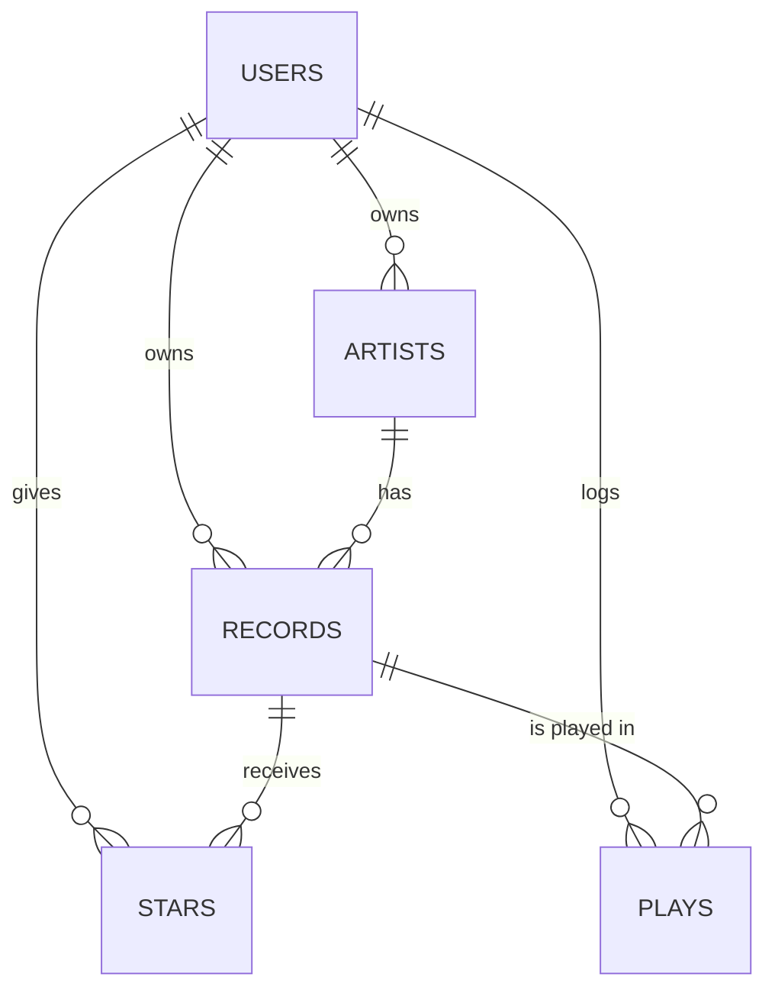

# PLAN.md: Crate, a vinyl collection tracker

## 1. Pitch

I'm building **Crate**, a web app for tracking my vinyl collection, because I keep buying records and lose track of what I already own, so I've almost bought the same album twice. I'll use it about 2 to 3 times a week: when I buy a record, when I put one on, and when I'm in a record store checking whether I already own something.

## 2. Features

Numbered in the order I'll build them. Features 1 to 7 are the required spine; 8 to 10 are my own.

1. **Sign up and login.** As a new visitor, I want to create an account with my email and a password, then log in and log out, so that my collection is private to me.
2. **Data model.** As a collector, I want my artists and records stored in separate, linked tables, so that one artist can have many records and I can open an artist to see everything I own by them.
3. **Create, read, update, delete.** As a collector, I want to add a record (title, artist, release year, format, genre, condition, price paid, purchase date, 1 to 5 rating, notes), see my collection as a list, open a record's detail page, edit it, and delete it after an "Are you sure?" confirmation, so that my collection stays accurate.
4. **Validation.** As a collector, I want the form to stop me with a friendly message if title, artist or format is blank, if the rating isn't 1 to 5, or if the release year is in the future, so that I never save a broken entry.
5. **Stars.** As a collector, I want to star my favorite records and open a "Starred" view, so that I can find my go-to records quickly.
6. **Find things.** As a collector, I want to search by title or artist, filter by genre and format, and sort by newest added, highest rated, release year, or price paid, so that I can find any record in a few seconds.
7. **Dashboard.** As a collector, I want a dashboard with total records, total spent, average rating, and a bar chart of records by genre, so that I can see the shape of my collection at a glance.
8. **Random pick.** As a collector, I want a "What should I spin tonight?" button that picks a random record from my collection, optionally within one genre, so that I play records I've forgotten about.
9. **Spin log.** As a collector, I want to log each time I play a record and see a play count on every record, so that I know what I actually listen to.
10. **Wishlist.** As a collector, I want to save records I don't own yet as "Wishlist" and see them on their own page, so that I know what to look for when I'm digging in a record store.

## 3. Database

Five tables. Every table except `users` has a `user_id`, so every query can be limited to the logged-in user.

**users**

| Column | Type | Notes |
|---|---|---|
| id | number | Primary key |
| email | text | Unique, required |
| password_hash | text | Never the plain password |
| display_name | text | Shown in the header |
| created_at | date | |

**artists**

| Column | Type | Notes |
|---|---|---|
| id | number | Primary key |
| user_id | number | Links to users.id |
| name | text | Required |
| country | text | Optional |
| created_at | date | |

**records**

| Column | Type | Notes |
|---|---|---|
| id | number | Primary key |
| user_id | number | Links to users.id |
| artist_id | number | Links to artists.id |
| title | text | Required |
| release_year | number | 1900 to this year |
| format | text | LP, EP, 7-inch, or Box set; required |
| genre | text | e.g. Jazz, Rock, Hip-hop, Soul |
| condition | text | Mint, VG+, VG, or G |
| price_paid | number | In dollars |
| purchase_date | date | |
| rating | number | 1 to 5 |
| is_wishlist | true/false | Default false; added in feature 10 |
| notes | text | Optional |
| created_at | date | Used for "newest first" |

**stars** (junction table between users and records)

| Column | Type | Notes |
|---|---|---|
| id | number | Primary key |
| user_id | number | Links to users.id |
| record_id | number | Links to records.id |
| created_at | date | |

One row means "this user starred this record." The pair (user_id, record_id) is unique, so a record can't be starred twice.

**plays** (added in feature 9)

| Column | Type | Notes |
|---|---|---|
| id | number | Primary key |
| user_id | number | Links to users.id |
| record_id | number | Links to records.id |
| played_on | date | |
| note | text | Optional, e.g. "side B only" |

**How the tables connect**

- One user has many artists, many records, and many plays (one-to-many).
- One artist has many records (one-to-many).
- One record has many plays (one-to-many).
- Users and records are many-to-many through `stars`.

## 4. Tests

1. **Data isolation.** Given User A has added the record "Kind of Blue" by Miles Davis, when User B logs in and asks for the record list and for that record's detail page, then User B's list is empty and the detail page returns "not found."
2. **Dashboard.** Given a user with three records rated 5, 4 and 3 that cost $30, $25 and $20, when the dashboard stats are calculated, then the total is 3 records, total spent is $75.00, and the average rating is 4.0.

## 5. Technologies

- **Coding agent: Replit Agent.** I used it for Assignments A to C, and it builds, runs and hosts the app in one place.
- **App stack: whatever Agent chooses (likely React front end, Node/Express back end).** I'd rather spend my time checking behavior than picking frameworks.
- **Database: Replit's built-in PostgreSQL.** It's a real relational database, so foreign keys and the stars junction table work the way the plan describes.
- **Sign up and login: email and password, hashed with bcrypt, kept in a session cookie.** Anyone can sign up without a Replit account, which matters for the live sign-up at demo day and for the stranger test.
- **Hosting: Replit Deployments (Autoscale).** One click republishes the live URL after each merge.
- **Libraries: Recharts or Chart.js for the dashboard chart, and Vitest or Jest with Supertest for the two tests.** They're the standard choices Agent knows well.
- **Version control: GitHub.** Every change reaches main through an Issue, a branch and a pull request.

## 6. Design

A warm record-store feel. Cream background (#F5EFE6), near-black text (#1E1E1E), and a burnt-orange accent (#D9622B) for buttons and stars. The collection shows as a grid of square cards like album covers, with rounded corners and a clean sans-serif font. Inspiration: Discogs, for how it organizes a collection by artist, format, genre and condition.

## 7. Risks and cuts

- **Least sure I can build:** sign up, login, and data isolation. Every query has to be filtered by the logged-in user, and one missed filter leaks data. Test 1 is there to catch exactly that. A second risk is that the live app may use a separate production database, so my real entries have to be added on the live URL.
- **Cut first if I run out of time:** the wishlist (feature 10). If I'm still short, the spin log shrinks to a single "last played" date on each record instead of its own table.

## 8. Plan vs. Reality

<!-- Add this at the end. Do not edit the sections above to match what happened. -->

| Planned feature | Shipped / Changed / Cut | Status (Done/Backlogged) | Learning | What changed and why (one line) |
|---|---|---|---|---|
| 1. Sign up and login | Changed | Done | The plan named a tech stack I never checked | Works as planned (email, bcrypt, session cookie), but Agent built server-rendered pages instead of the React front end I guessed in section 5. |
| 2. Data model | Shipped | Done | The database can enforce rules, not just store data | Matches section 3, and Agent added a constraint so a record can only point to an artist owned by the same user. |
| 3. Create, read, update, delete | Shipped | Done | A smoke test catches what reading code misses | Shipped as planned; the first run failed on missing imports and a date-format bug, both fixed before merge. |
| 4. Validation | Changed | Done | Browser defaults can fight your own UX | The browser's built-in "required" popups blocked my friendly messages, so one shared validator now runs in the browser and on the server. |
| 5. Stars | Shipped | Done | A junction table is just one row per relationship | One shared stars table with a unique (user_id, record_id) pair, exactly as planned. |
| 6. Find things | Shipped | Done | Security has to be asked for explicitly | Search, filters and sort as planned, with bound SQL parameters and filters kept in the URL. |
| 7. Dashboard | Changed | Done | "Use library X" in a plan is a guess, not a requirement | The chart is plain HTML/CSS bars instead of Recharts or Chart.js; stats live in a testable computeStats function. |
| 8. Random pick | Shipped | Done | Small features are the easiest to demo | Shipped as planned, including the optional genre filter. |
| 9. Spin log | Changed | Done | Schema details I wrote didn't fit the existing tables | The plays table shipped, but the planned link needed a constraint records didn't have, so ownership is checked in the route instead. |
| 10. Wishlist | Shipped (late) | Done | Plan the cut list before you need it | It was first on my cut list and nearly cut at the deadline; it shipped last in a short final loop, adding a column with a migration-safe ALTER TABLE. |

**Also not in the plan:** the live app has its own production database. I asked Agent to create tables on startup; it pushed back, saying Replit's publish step copies the development schema to production, and I went with its call (PR #24).
