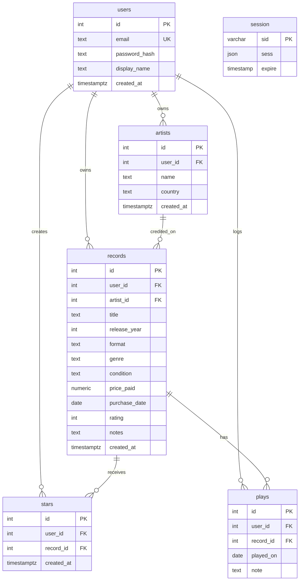

# Database schema

This documents the tables and constraints found in Crate's PostgreSQL development database, including the `session` table used by `connect-pg-simple`. `SERIAL` columns are stored as integers with an associated sequence. Nullable columns are marked optional.

Replit Publish compares the development and production schemas and applies the schema changes to production before the deployment goes live. The session table is included in `db/schema.sql` and is part of that schema. The application does not run DDL at startup.

## Tables

### `users`

Each account belongs to one user row.

| Column | Type | Notes |
| --- | --- | --- |
| `id` | SERIAL (integer) | Primary key |
| `email` | TEXT | Required; unique |
| `password_hash` | TEXT | Required |
| `display_name` | TEXT | Required |
| `created_at` | TIMESTAMPTZ | Required; defaults to the current time |

### `artists`

Artists belong to a user. `(id, user_id)` is also unique so records can reference an artist owned by the same user.

| Column | Type | Notes |
| --- | --- | --- |
| `id` | SERIAL (integer) | Primary key |
| `user_id` | INTEGER | Required; references `users.id`, cascades on user deletion |
| `name` | TEXT | Required |
| `country` | TEXT | Optional |
| `created_at` | TIMESTAMPTZ | Required; defaults to the current time |

### `records`

Records belong to a user and reference an artist owned by that same user. Deleting a user or referenced artist cascades to their records.

| Column | Type | Notes |
| --- | --- | --- |
| `id` | SERIAL (integer) | Primary key |
| `user_id` | INTEGER | Required; references `users.id` |
| `artist_id` | INTEGER | Required; part of a composite foreign key to `artists(id, user_id)` |
| `title` | TEXT | Required |
| `release_year` | INTEGER | Optional; if set, must be at least 1900 |
| `format` | TEXT | Required |
| `genre` | TEXT | Optional |
| `condition` | TEXT | Optional |
| `price_paid` | NUMERIC(10, 2) | Optional |
| `purchase_date` | DATE | Optional |
| `rating` | INTEGER | Optional; if set, must be from 1 to 5 |
| `notes` | TEXT | Optional |
| `created_at` | TIMESTAMPTZ | Required; defaults to the current time |

### `stars`

Stars connect users to records. `(user_id, record_id)` is unique, so a user can star a record only once. Deleting the user or record cascades to the star row.

| Column | Type | Notes |
| --- | --- | --- |
| `id` | SERIAL (integer) | Primary key |
| `user_id` | INTEGER | Required; references `users.id` |
| `record_id` | INTEGER | Required; references `records.id` |
| `created_at` | TIMESTAMPTZ | Required; defaults to the current time |

### `plays`

Each row logs a play for a record. The user and record references cascade on deletion; the application checks that the logged-in user owns the record.

| Column | Type | Notes |
| --- | --- | --- |
| `id` | SERIAL (integer) | Primary key |
| `user_id` | INTEGER | Required; references `users.id` |
| `record_id` | INTEGER | Required; references `records.id` |
| `played_on` | DATE | Required; defaults to the current date |
| `note` | TEXT | Optional |

### `session`

This table stores Express sessions for `connect-pg-simple`. It is independent of the application user tables.

| Column | Type | Notes |
| --- | --- | --- |
| `sid` | VARCHAR | Primary key; required |
| `sess` | JSON | Required |
| `expire` | TIMESTAMP(6) without time zone | Required |

## Relationships

- A user can have many artists and records; deleting a user cascades to those rows.
- A record references an artist and its user through `(artist_id, user_id)`, ensuring the record's artist belongs to the same user.
- Stars and plays each reference a user and a record. The application scopes these operations to the signed-in user's data; the database's individual foreign keys do not enforce that the star or play's `user_id` matches the record owner.
- A user or record deletion cascades to its stars and plays.
- Session rows have no foreign key to `users`; they are managed by the session store.

